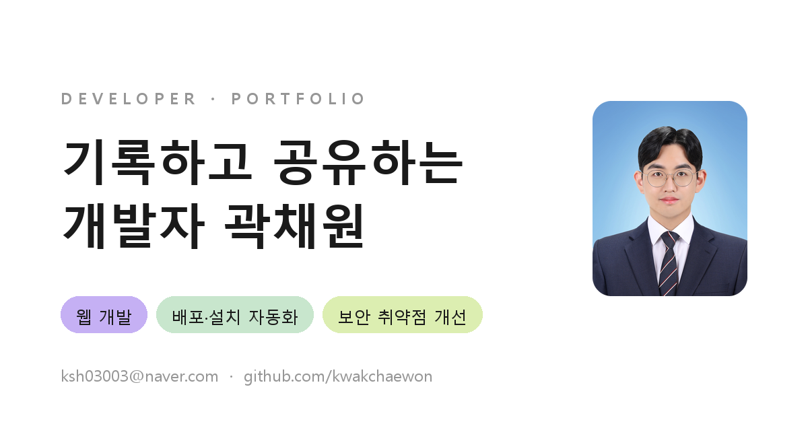

# 곽채원 · 포트폴리오

> 비효율을 찾아내 표준으로 만드는 4년차 개발자 곽채원의 웹 포트폴리오입니다.

**🔗 Live — [kwakchaewon.github.io/chaewon_portfolio](https://kwakchaewon.github.io/chaewon_portfolio/)**



<br>

## 수록 내용

### Experience
| 기간 | 소속 | 역할 |
| --- | --- | --- |
| 2024.02 – 현재 | 이든티앤에스 AX-A 개발본부 | 대리 · 백엔드 · 고객사 구축 · 기술 지원 |
| 2023.02 – 2023.07 | KT AIVLE School | AI 개발자 트랙 수료 |
| 2019.11 – 2020.10 | 태화이노베이션 SI 사업부 | 사원 · K 은행 SI 유지보수 |

### Projects
| # | 프로젝트 | 기간 | 요약 |
| --- | --- | --- | --- |
| 01 | 표준 Oracle 환경 대응 리팩토링 | 2024.04 – 2024.11 | MariaDB + MyBatis 기반 API · 스케줄러 200개 이상을 JPA + QueryDSL로 전환. Java · Oracle · MariaDB 호환 데이터 타입 설계, 동적 쿼리 표준화, 통계·집계 스케줄러 500건 단위 flush·clear 적용(메모리 400MB 이내 유지). Oracle 환경 지원으로 K사 첫 수주 |
| 02 | RPM · Inno Setup 기반 설치 패키지 표준화 | 2024.12 – 현재 | Flyway 마이그레이션 이력 관리, [Linux] rpmbuild 기반 8개 OS 설치 자동화 · 폐쇄망 docker save/load 반입, [Windows] Inno Setup 7 단일 .exe 라이프사이클 관리 · 설치 전 34개 항목 자동 점검. 설치·장애 대응 비용 90% 이상 절감, 배포 용량 53% 최적화(1,893MB → 887MB) |
| 02 | C사 MySQL EOS 대응 전환 및 이중화 구성 | 2024.12 – 현재 | MySQL 8.0.40 → 8.4 LTS 복제 기반 전환, 로드밸런서 VIP · WEB/WAS 2대 · NAS · Redis Sentinel 3대 · DB VIP Active/Standby 이중화. 이외 23개 고객사(금융 · 대기업 · 공공기관)에 자사 솔루션 구축 |
| 03 | 보안 취약점 대응 | 2025.07 – 2025.12 | 「주요정보통신기반시설 기술적 취약점 분석·평가 방법(2021)」 기준으로 Web · WAS · DB · OS 4개 계층 취약점 70건 이상 조치, 납품용 보안 증빙 자료 표준화 |

### AI 활용 케이스

| # | 영역 | 주요 성과 | 요약 |
| --- | --- | --- | --- |
| 01 | 사내 문서 검색 RAG 파이프라인 (직접 개발) | Qdrant 하이브리드 검색 | dense(4096차원) + BM25 하이브리드, 표준 payload 24개 필드, uuid5 멱등 적재, 임베딩 서버 헬스체크 · 자동 재시작 (Python) |
| 02 | OpenKB 기반 사내 지식 위키 전환 | 문서 1,252건 지식화 | 조각난 문맥 문제로 벡터 RAG에서 LLM 위키 방식으로 전환, 골든셋 + LLM 심판 2단계 평가로 기존·신규 KB A/B 비교 |
| 03 | 스킬 · 템플릿 기반 업무 표준화 | 커밋 컨벤션 위반 25% → 3% · 입력 토큰 40% 절감 · 문서 작성 20~30분 → 5분 | auto-commit · create-pr · write-release-note 스킬, Notion MCP 기반 고객사 히스토리 · 릴리즈 노트 자동 작성, Claude Design 디자인 시스템 → Vue 공통 컴포넌트 |

<br>

## 기술 스택

| 분류 | 사용 기술 |
| --- | --- |
| Language | Java, Kotlin, Python |
| Framework | Spring Boot, Django, Vue |
| Infra | Docker, Jenkins, RPM, Inno Setup, Apache, AWS, Redis, Qdrant |
| Tool | Claude Code & Design, Notion, Git |

**Certification** · AWS Solutions Architect Associate (2026.09) · 정보처리기사 (2025.09) · SQLD (2021.03) · 컴퓨터활용능력 1급 (2020.12) · 1종 보통운전면허

**Awards** · AIVLE 빅프로젝트 장려상 · 순천향대 독후감 스피치 대회 장려상 · 우수 사회복무요원 표창

<br>

## 저장소 구조

```
.
├── index.html              # 슬라이드 마크업 (9장)
├── css/
│   ├── fonts.css           # Pretendard · JetBrains Mono @font-face
│   ├── design-system.css   # 디자인 토큰 · 텍스트 프리미티브 · 모션
│   └── components.css      # 슬라이드별 컴포넌트
├── js/
│   ├── deck-stage.js       # <deck-stage> 웹 컴포넌트 (레일 · 스케일 · 인쇄)
│   └── countup.js          # 수치 카운트업
├── assets/
│   ├── fonts/              # woff2 (Pretendard Variable · JetBrains Mono 6종)
│   ├── profile.jpg         # 프로필 사진
│   └── ...                 # OG 이미지 · 파비콘
├── docs/
│   └── 곽채원 · 포트폴리오.pdf   # PDF 버전
├── robots.txt
└── sitemap.xml
```

빌드 단계나 의존성 설치가 없습니다. 정적 파일을 그대로 서빙하면 됩니다.

<br>

## 로컬에서 보기

웹폰트와 스크립트가 상대 경로로 로드되므로 **로컬 서버가 필요합니다.** `file://`로 직접 열면 폰트가 적용되지 않습니다.

```bash
python -m http.server 8000
# http://localhost:8000
```

<br>

## PDF 내보내기

`docs/` 의 PDF는 브라우저 인쇄로 만듭니다. `deck-stage.js`가 `@page` 크기(1920×1080)와 인쇄용 스타일을 주입하므로 슬라이드 1장이 PDF 1쪽이 됩니다.

반드시 **`http://localhost:8000` 에서 인쇄**하세요. `file://`에서는 웹폰트가 차단되어 시스템 폰트로 출력됩니다.

```
Chrome → 인쇄 → 대상: PDF로 저장 → 여백: 없음 → 배경 그래픽: 켬
```

<br>

## 배포

`main` 브랜치 루트를 GitHub Pages가 그대로 서빙합니다. `index.html`을 수정해 push하면 자동 반영됩니다.

<br>

## 연락처

- 📧 ksh03003@naver.com
- 🐙 [github.com/kwakchaewon](https://github.com/kwakchaewon)
